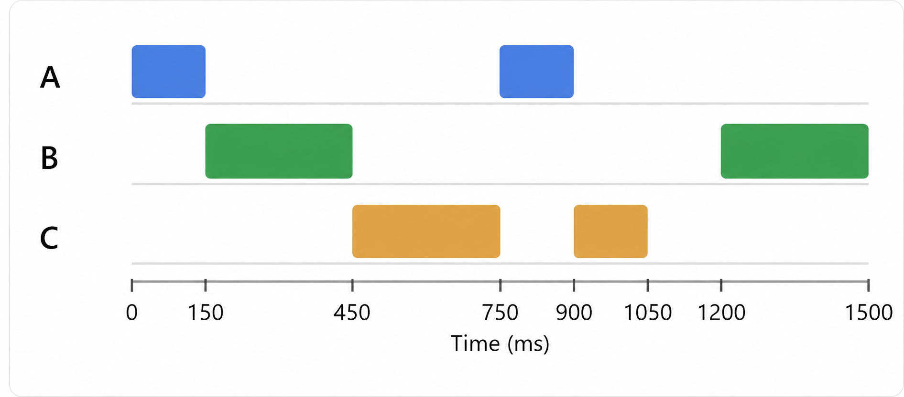
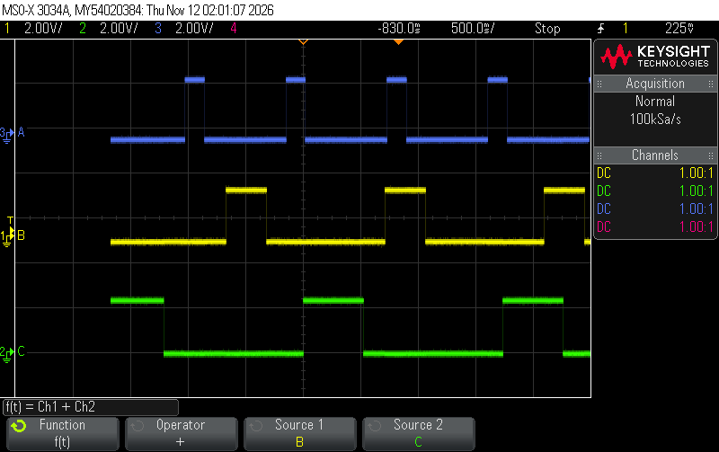
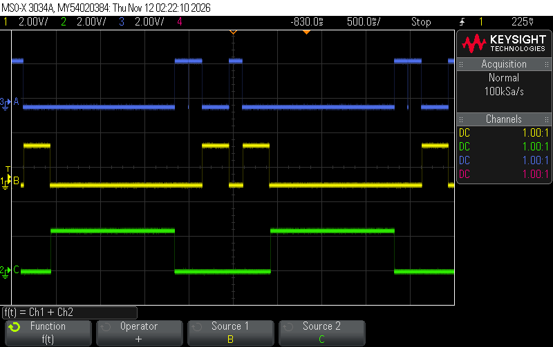

# ws5-rtos-skeleton

* Name: Xinyi Gong
* GitHub username: xinyigbytes10
* GitHub Repository URL: 
* Description of hardware: (embedded hardware, laptop, etc) 

The hardware setup includes an ATmega328PB microcontroller, three LEDs with current-limiting resistors, a laptop running MPLAB X IDE, and a Keysight oscilloscope to measure the output signals.

PB0 → Task A (Blue / CH3): 150 ms ON, 750 ms period.

PB1 → Task B (Yellow / CH1): 300 ms ON, 1200 ms period.

PB2 → Task C (Green / CH2): 450 ms ON, 1500 ms period.

## R1

Yes, the task set is RM schedulable. No adjustment to Task B is needed.

Under Rate Monotonic Scheduling (RMS), tasks with shorter periods have higher priorities.

| Task | CPU Time (ms) | Period (ms) | Priority |
|------|---------------|-------------|----------|
| A | 150 | 750 | 3 (Highest) |
| B | 300 | 1200 | 2 |
| C | 450 | 1500 | 1 (Lowest) |

U = 150/750 + 300/1200 + 450/1500

U = 0.20 + 0.25 + 0.30 = 0.75 = 75%

For 3 tasks, the RMS utilization bound is:

U_max = 3(2^(1/3) - 1) = 0.7798 = 77.98%

Since 75% < 77.98%, the task set is RM schedulable.

### Scheduling Diagram

All tasks meet their deadlines. The original task set is schedulable under RMS, so Task B's CPU time does not need to be changed.

## I1:

The oscilloscope shows that Task A, B, and C have different pulse widths and periods, approximately following the expected RMS scheduling behavior. Some HIGH pulses overlap, which is expected in the preemptive implementation because tasks release the CPU during vTaskDelay(). Small timing differences may result from the FreeRTOS tick resolution, watchdog timer accuracy, and task scheduling delays.

## I2: 

The oscilloscope shows the output signals of Task A (blue), Task B (yellow), and Task C (green). The HIGH pulses do not overlap, indicating that only one task executes at a time, as expected in the RMS blocking implementation. Some timing differences occur because tasks must wait for other tasks to finish before executing.
